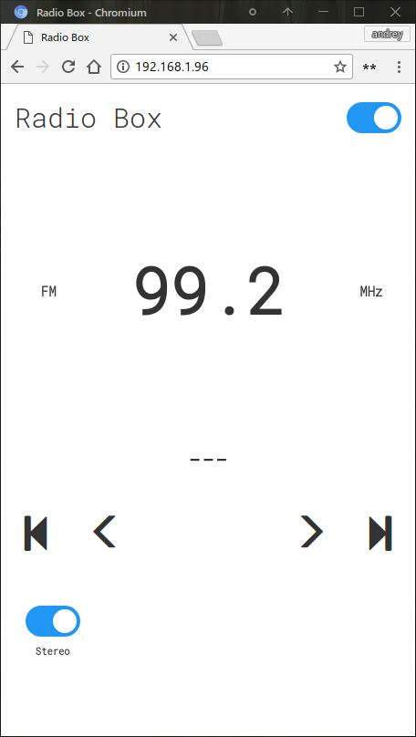

# Radio Box


[](https://github.com/anabolyc/esp8266-radio-box/actions/workflows/esphome.yml)

A small open-source board with a 240x240 colour screen, three buttons and a battery socket. It started as a self-hosted FM radio with a web interface, later ran a Space Invaders emulator, and now works as a **Home Assistant remote**: a "now playing" screen and remote control for [Music Assistant](https://music-assistant.io/) speakers over the Sendspin protocol, with quick access to radio stations, ambient scenes and lights.

Hardware and software are shared under the GPLv3 license.


## Sendspin remote

ESPHome firmware in [firmware/esphome](/firmware/esphome), for a Radio Box fitted with a LOLIN S3 mini (recommended) or S2 mini.

- **Now playing:** cover art, title and artist, progress, playback state, volume and a clock, for the Music Assistant speaker group the remote joins
- **Buttons:** volume, play/pause, previous/next track and seek, with an on-screen volume ring
- **Lists:** pick and play any SomaFM station, or start an ambient scene (mood audio and lights) through Home Assistant
- **Lights:** colour, brightness and on/off for a group of lights
- **Battery friendly:** the display turns off after a minute, and the remote goes into deep sleep after five; any button wakes it


There are three configurations:

| Config | Board | What it does |
| --- | --- | --- |
| [sendspin-remote-02.yaml](/firmware/esphome/sendspin-remote-02.yaml) | LOLIN S3 mini (2 MB PSRAM) | Everything, with full-size cover art. Recommended. |
| [remote-01-light.yaml](/firmware/esphome/remote-01-light.yaml) | LOLIN S2 mini (no PSRAM) | Clock, lists and Lights screen, without the Sendspin player |
| [sendspin-remote-01.yaml](/firmware/esphome/sendspin-remote-01.yaml) | LOLIN S2 mini (no PSRAM) | Everything, with low-resolution cover art. Very tight on memory. |

Setup, button reference, configuration and known limitations are in the [Sendspin remote README](/firmware/esphome/README.md).

## Key features of the board

- Onboard 240x240 px TFT screen
- 3 physical buttons (Rev D)
- Onboard dual AAA battery socket with voltage boost converter
- Built-in CH340 serial bridge for one-click firmware upload
- Onboard RGB LED for status indication (Rev B only)

## Original firmware

The board's earlier firmware is still here, and still works.

### FM radio

[firmware/esp8266-radio-box](/firmware/esp8266-radio-box): a TEA5767 or RDA5807M FM radio module with a self-hosted web interface on the ESP8266.

- WiFiManager with a captive portal for the first Wi-Fi setup
- Built-in web server hosting a mobile-friendly web app
- WebSocket server for client-server communication

The radio module code is based on the work of [Matthias Hertel](https://github.com/mathertel/Radio), with support for both RDA5807 and TEA5767 modules. The RDA5807 is the better choice:

* it has higher output power, so you can connect headphones directly
* it has hardware volume control, RDS, bass boost, mute and more; the TEA5767 has none of those
* the TEA5767 seems to have better reception, but with a good signal it makes little difference

### Space Invaders

[firmware/esp-space-invaders](/firmware/esp-space-invaders): a true emulation, ported from the [invaders repo](https://github.com/jscrane/invaders) by [jscrane](https://github.com/jscrane). Starting from revision D (2023) the board comes as a DIY kit with 3 physical buttons, which made this possible.

Keypad support uses interrupt-based clicks and timer-based long-press detection. A single click gives "Left", "Fire" and "Right"; a long press gives "Player 1 start", "Insert Coin" and "Pause".


### How to build and flash

1. Install [PlatformIO](https://platformio.org/) (VS Code with the plugin at the time of writing).
1. Clone the project with submodules: `git clone --recurse-submodules https://github.com/anabolyc/esp8266-radio-box`
1. Open either the [esp8266-radio-box](/firmware/esp8266-radio-box) or the [esp-space-invaders](/firmware/esp-space-invaders) project in [VS Code](https://github.com/Microsoft/vscode) and build it with the `Build` command. Use the `RadioBox-B` or `RadioBox-D` environment, depending on the board revision.
1. Use the `Upload Filesystem Image` task to build and upload the files the web server uses.
1. Use `Upload` or `Upload and Monitor` to flash the firmware onto the device.
1. The radio firmware uses [WiFiManager](https://github.com/tzapu/WiFiManager) for Wi-Fi setup. The first time, the device won't find a known Wi-Fi network and starts its own, named ESP-XXXXXX after its chip ID. Connect to it, and the captive portal asks for your Wi-Fi credentials. From then on the device connects to that network automatically.
1. Open `http://device-ip` or `http://ESP-XXXXXX.lan` to control the radio from the web app.



### How to debug the web app

To debug the web interface directly from the IDE, without uploading each change to the ESP:

1. Run the `start debug web-server` task in VS Code. It assumes [Docker](https://www.docker.com/) is installed, and starts a light HTTP server on port 8080.
2. Find this line and change it to your device's IP. The app is then hosted on your PC, but talks to the ESP over WebSockets as its backend.

   ```js
   var NODE_IP = "192.168.0.36";
   ```

3. Open the app at `http://localhost:8080`.

## Hardware

Design files are in the [hardware](/hardware) section.

## Kit contents


## Assembly instructions

See the [project page](https://hackaday.io/project/189326-space-invaders-radio-diy-kit).

## Look

### As a Sendspin remote


### Revision D


### Revision B


## Where to buy

You can support me by buying the kit on [Tindie](https://www.tindie.com/products/sonocotta/esp8266-radio-box/).
